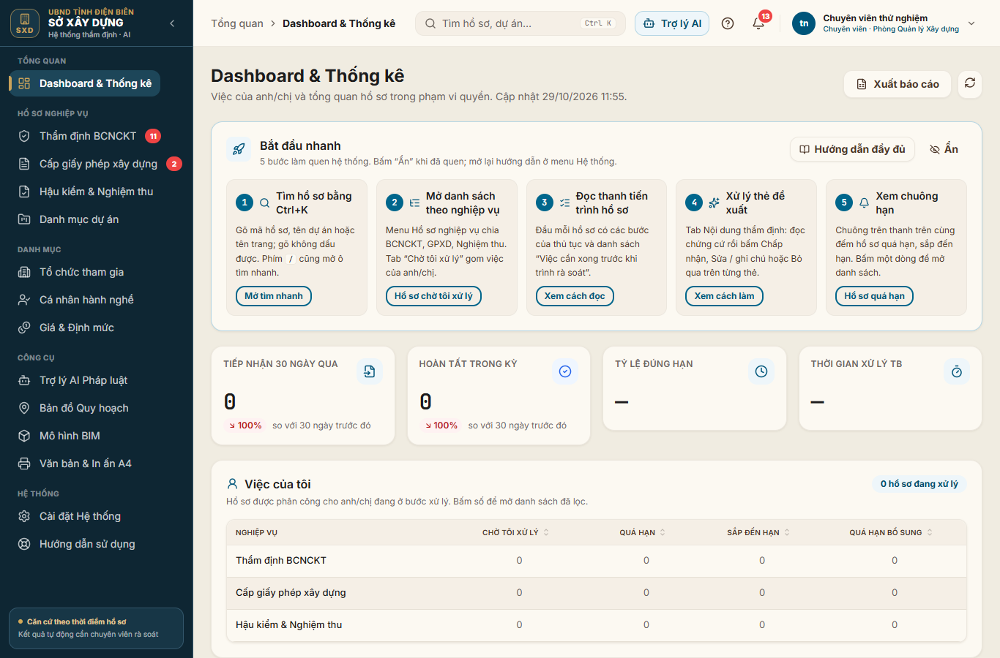
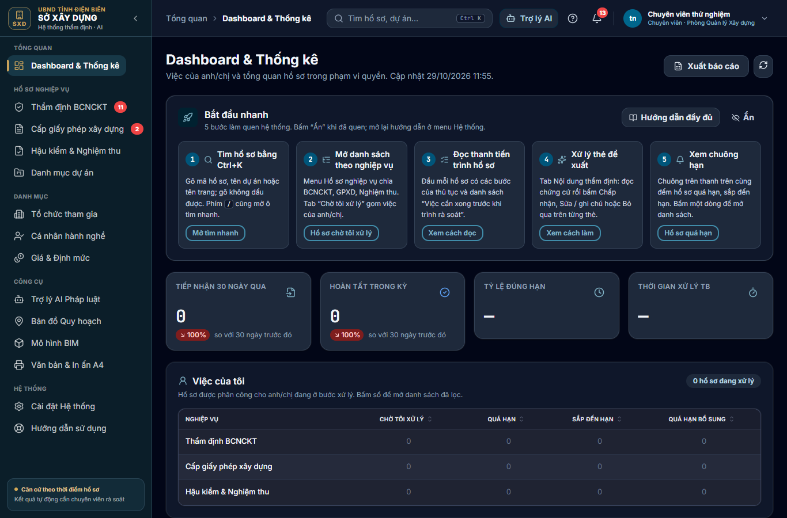
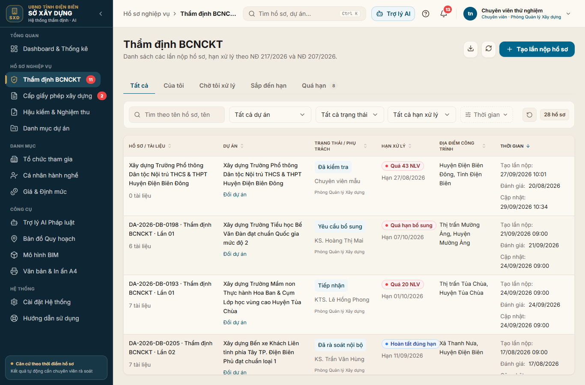
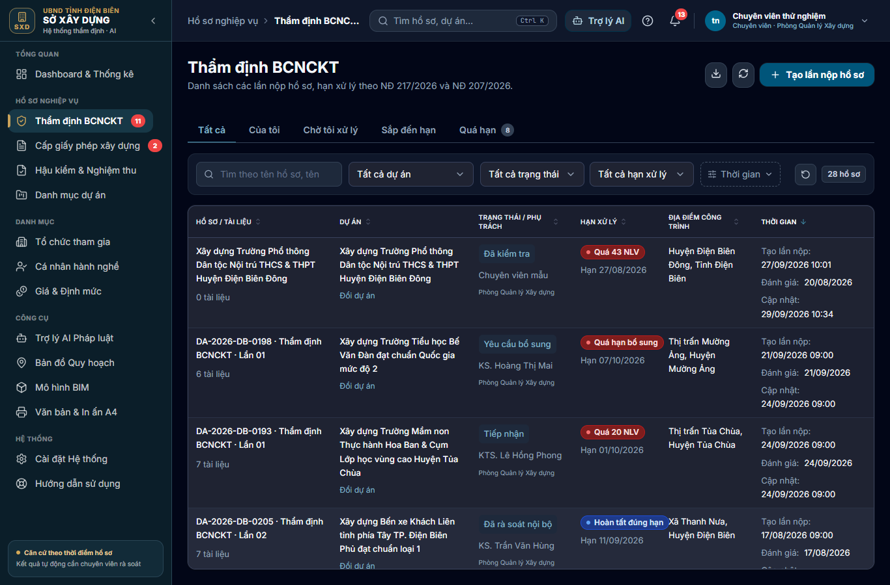
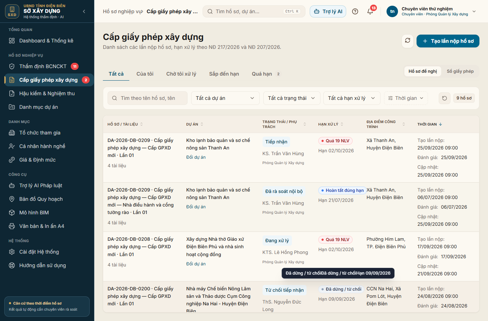
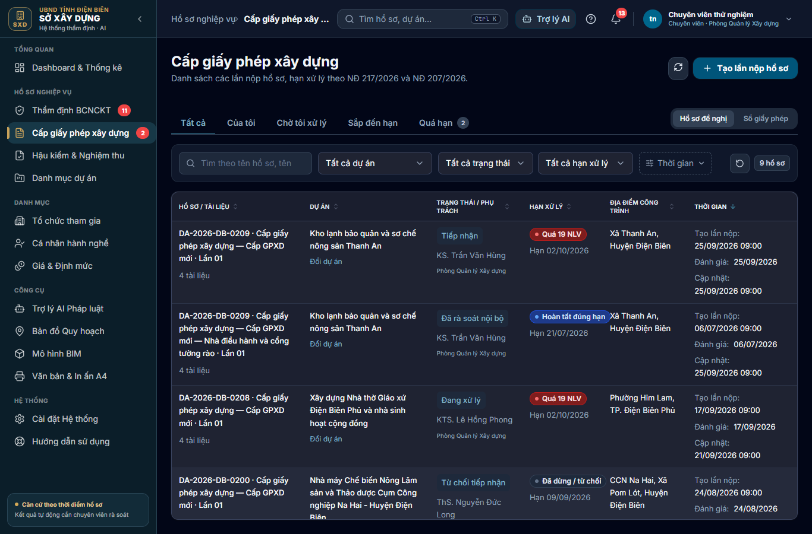

# Bàn giao nâng cấp giao diện (U0–U7) — 29/10/2026

**Nhánh:** `feat/ui-ux-cic-hud-palette`.

**Trạng thái trên `main`:**
- Đã có đến U5 (`1b9f38b`).
- U6–U7 nằm trên nhánh và bản preview Vercel của nhánh. Chưa đưa lên `main` vì bản production cần thêm 3 biến môi trường cho Python Function (xem mục 6).

**Chuẩn thiết kế:**
- Tài liệu: [UI_DESIGN_SYSTEM.md](UI_DESIGN_SYSTEM.md).
- Trang xem toàn bộ component: `/dev/ui`.
- Hướng dẫn người dùng: `/help`.

## 1. Đã làm theo từng giai đoạn

| Giai đoạn | Nội dung chính | Commit |
| --- | --- | --- |
| Bộ màu | 12 bộ màu hai tông đồng bộ cic-hud (mặc định "Lam công vụ"), menu trái nền tối, màn đăng nhập theo bộ màu | `a5224e7` |
| U1 Component nền | Button, Card, Badge, EmptyState, Skeleton, PageHeader, Modal (chặn mất dữ liệu), confirm(), toast, Tabs, KpiTile, Stepper, Timeline, DataTable (kéo cột, sắp xếp, chọn cột, bàn phím); `lint:ui` chặt hơn | `f1ed145` |
| U2 Khung ứng dụng | Menu nhóm theo nghiệp vụ có số việc gấp, tìm nhanh Ctrl+K hoặc `/`, chuông hạn xử lý, menu tài khoản; nút Trợ lý AI lên thanh trên | `3bea9d2` |
| U3 Danh sách | Tab Tất cả / Của tôi / Chờ tôi xử lý / Sắp đến hạn / Quá hạn (API `scope`), chip bộ lọc, gập bộ lọc thời gian, cột người phụ trách, cột phụ tự ẩn | `a590ea0` |
| U4 Hồ sơ | Phần đầu hồ sơ có thanh tiến trình theo bước pháp lý và việc cần xong trước khi trình; thẻ đề xuất; xem trước A4 có phóng to, chuyển trang, ảnh thu nhỏ | `1b2edc0` |
| U5 Dashboard | KPI 30 ngày so với kỳ trước, "Việc của tôi", hạn xử lý theo chuyên viên, xuất CSV | `1b9f38b` |
| U6 Trải nghiệm chung | Trang Hướng dẫn, thẻ "Bắt đầu nhanh", xác nhận trước thao tác không hoàn tác được, toast, "Thử lại", gallery xem/sửa/xóa ảnh, `EntityLink` trong panel dự án | `aaf08a6` |
| U7 Hình ảnh và responsive | Test bố cục 4 khổ màn hình, ảnh sáng/tối để duyệt, sửa lỗi tràn ở tablet và thanh lọc 2 hàng ở 1366px | `49ebe05` |

## 2. Kiểm tra bố cục tự động (U7)

File `tests/e2e/specs/layout.spec.ts` chạy ở 4 khổ màn hình: 768, 1024, 1366 và 1920px.

| Kiểm tra | Cách kiểm |
| --- | --- |
| Không cuộn ngang | Trang và vùng nội dung chính không rộng hơn màn hình. Bảng rộng cuộn trong khung của nó. |
| Khung ứng dụng | Menu "Điều hướng" và nút "Tìm nhanh (Ctrl+K)" luôn hiển thị. |
| Không bị che | Khi có phân trang, nút "Trang sau" nằm trên cùng. Góc dưới phải vùng nội dung không bị phần tử nổi đè. |
| Nhãn hạn | Nhãn hạn trong bảng nằm trên một dòng (cao dưới 32px). |
| Thanh lọc | Từ 1366px, tất cả bộ lọc của danh sách hồ sơ nằm trên một hàng. |
| Ảnh để duyệt | Ảnh chế độ "Bảo vệ mắt" và "Tối" của Dashboard, danh sách BCNCKT, danh sách GPXD được đính kèm vào báo cáo Playwright, và cũng được upload trong CI. |

**Không dùng so sánh ảnh theo pixel:**
- Font trên Windows và Linux khác nhau.
- Dữ liệu demo thay đổi theo ngày.

Vì vậy so sánh pixel sẽ báo đỏ liên tục dù giao diện không lỗi. Các kiểm tra trên không phụ thuộc dữ liệu nên chạy giống nhau ở CI (demo) và cloud staging.

**Lỗi tìm ra và đã sửa trong U7:**
- **Tablet 768px, dashboard tràn ngang 234px.** Menu trái vẫn để đầy đủ (264px), và bảng "Việc của tôi" đẩy khung ra ngoài. Đã sửa:
  - menu tự thu gọn dưới 1024px;
  - khung bọc bảng có `min-w-0` để bảng cuộn bên trong.
- **1366px, thanh lọc danh sách hồ sơ xuống 2 hàng** (cao 112px). Đã thu gọn ô tìm kiếm, ô chọn dự án và trạng thái; các ô rộng lại ở màn rất lớn. Thanh lọc còn 1 hàng (64px).

## 3. Ảnh giao diện

Ảnh trong `docs/ui-delivery/`, chụp ở 1366×900 trên dữ liệu cloud staging.

| Màn hình | Bảo vệ mắt | Tối |
| --- | --- | --- |
| Dashboard |  |  |
| Danh sách BCNCKT |  |  |
| Danh sách GPXD |  |  |

## 4. Kết quả kiểm tra

| Lệnh | Kết quả |
| --- | --- |
| `pnpm typecheck`, `typecheck:core` | Đạt |
| `node scripts/lint-ui.mjs` | 0 vi phạm |
| `pnpm format:check`, `ruff format --check` | Đạt |
| `pnpm test:web` | 35/35 |
| `pnpm test:appraisal` | 148/148 |
| E2E nghiệp vụ (5 test) và E2E bố cục (U7) | Đạt trên cloud staging với thời gian chờ dài. Mỗi lần mở hồ sơ trên staging mất khoảng 4 giây (ghi nhận cho B2). |

## 5. Còn lại

| Hạng mục | Nội dung |
| --- | --- |
| B1 | Tách bước Trưởng phòng / Lãnh đạo, cấp số văn bản, hoàn thiện nghiệm thu |
| B2 | Tăng tốc truy vấn cloud (`GET /cases/{id}` khoảng 4 giây) |
| B4 | Dữ liệu demo theo ngày hiện tại: dữ liệu staging dừng ở tháng 9 nên KPI 30 ngày đang bằng 0 |
| B3 | AI thật, khi có credential |

## 6. Việc cần anh/chị làm

Để đưa U6–U7 lên `main`, Production trên Vercel cần thêm 3 biến (hiện mới có cho bản preview của nhánh):

| Biến | Giá trị |
| --- | --- |
| `APPRAISAL_INTERNAL_TOKEN` | Bí mật |
| `VITE_APPRAISAL_RUNTIME` | `cloud` |
| `APPRAISAL_ORIGIN` | `https://cic-qlhd-sxd.vercel.app` |

Nếu thiếu các biến này, `vercel-build.mjs` dừng build production có chủ đích.
